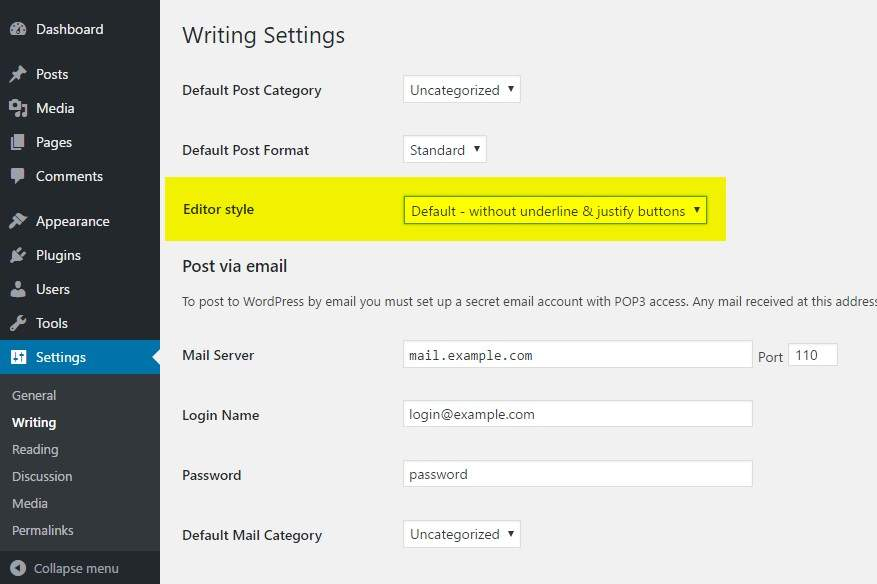
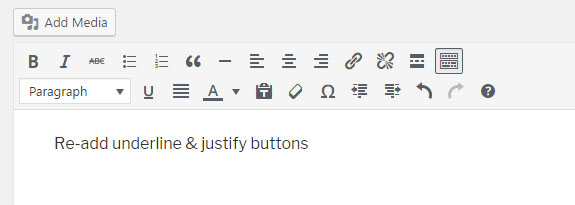

# Re-add text underline and justify

**Brings back the underline and justify buttons that WordPress 4.7 removed from the classic editor.**

WordPress 4.7 reorganised the TinyMCE toolbar and dropped two buttons people used every day: underline and justify. If your clients or your own habits depend on them, this plugin puts them back where they were, and that's all it does. No settings page of its own, no script on the front end.

It works with the classic editor, with the [Classic Editor](https://wordpress.org/plugins/classic-editor/) plugin, with the WYSIWYG fields of Advanced Custom Fields (free and Pro), and in the "Classic" block of Gutenberg.

Install it from wordpress.org: **[wordpress.org/plugins/re-add-underline-justify](https://wordpress.org/plugins/re-add-underline-justify/)**. This repository is a copy of the plugin's history, for reading the code. Releases are still published on wordpress.org.

## Options

Go to **Settings → Writing**, then pick an **Editor style**:

- **Without underline & justify buttons**: the WordPress default.
- **Default - Re-add underline & justify buttons**: what you get once the plugin is active.
- **Re-add justify only**.

  
  

Up to 0.1.4 there was a fourth option that also rearranged the toolbar the way it was before 4.7. It clashed with Gutenberg and was removed in 0.2. Sites that used it switch automatically to "Default - Re-add underline & justify buttons".

## How it works

The plugin hooks into the `mce_buttons` and `mce_buttons_2` filters and adds `alignjustify` and `underline` back to the TinyMCE toolbar, depending on the chosen option. The setting is stored in the `ratb_options` option and deleted when you uninstall the plugin.

## Requirements

WordPress 4.7 or newer. The latest release was tested up to WordPress 6.9.

## History

The full history comes from the plugin's SVN repository on wordpress.org, from the first release in November 2016 to today. Each version published on wordpress.org has its own tag (`0.1` to `0.4.2`). The banner, icon and screenshots of the plugin page are in `.wordpress-org/`.

The French version of this file is `README_FR.md`.

## License

GPLv2 or later, see `LICENSE`.
