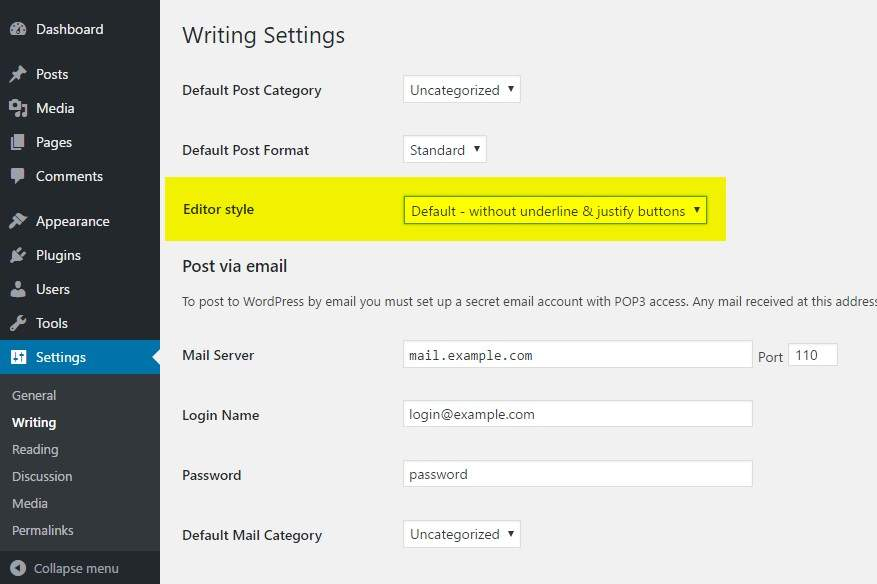
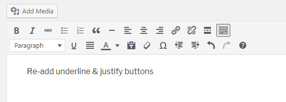

# Re-add text underline and justify

**Remet les boutons « souligner » et « justifier » que WordPress 4.7 a retirés de l'éditeur classique.**

WordPress 4.7 a réorganisé la barre d'outils de TinyMCE et supprimé deux boutons dont beaucoup se servaient tous les jours : souligner et justifier. Si vos clients ou vos propres habitudes en dépendent, ce plugin les remet à leur place, et c'est tout ce qu'il fait. Pas de page de réglages à lui, aucun script côté visiteur.

Il fonctionne avec l'éditeur classique, avec le plugin [Classic Editor](https://fr.wordpress.org/plugins/classic-editor/), avec les champs WYSIWYG d'Advanced Custom Fields (gratuit et Pro), et dans le bloc « Classique » de Gutenberg.

Pour l'installer, passez par wordpress.org : **[wordpress.org/plugins/re-add-underline-justify](https://fr.wordpress.org/plugins/re-add-underline-justify/)**. Ce dépôt est une copie de l'historique du plugin, pour lire le code. Les versions restent publiées sur wordpress.org.

## Options

Dans **Réglages → Écriture**, choisissez un **Style de l'éditeur** :

- **Sans les boutons souligner et justifier** : le comportement par défaut de WordPress.
- **Ajouter les boutons souligner & justifier** : ce que vous obtenez une fois le plugin activé.
- **Ajouter uniquement le bouton justifier**.

  
  

Jusqu'à la 0.1.4, une quatrième option remettait aussi la barre d'outils dans l'ordre d'avant la 4.7. Elle entrait en conflit avec Gutenberg et a été retirée en 0.2. Les sites qui l'utilisaient passent automatiquement sur « Ajouter les boutons souligner & justifier ».

## Fonctionnement

Le plugin s'accroche aux filtres `mce_buttons` et `mce_buttons_2` et rajoute `alignjustify` et `underline` dans la barre de TinyMCE, selon l'option choisie. Le réglage est enregistré dans l'option `ratb_options` et supprimé à la désinstallation.

## Prérequis

WordPress 4.7 ou plus récent. La dernière version a été testée jusqu'à WordPress 6.9.

## Historique

L'historique complet vient du dépôt SVN du plugin sur wordpress.org, de la première version en novembre 2016 jusqu'à aujourd'hui. Chaque version publiée sur wordpress.org a son tag (`0.1` à `0.4.2`). La bannière, l'icône et les captures de la page du plugin sont dans `.wordpress-org/`.

La version anglaise de ce fichier est `README.md`.

## Licence

GPLv2 ou ultérieure, voir `LICENSE`.
